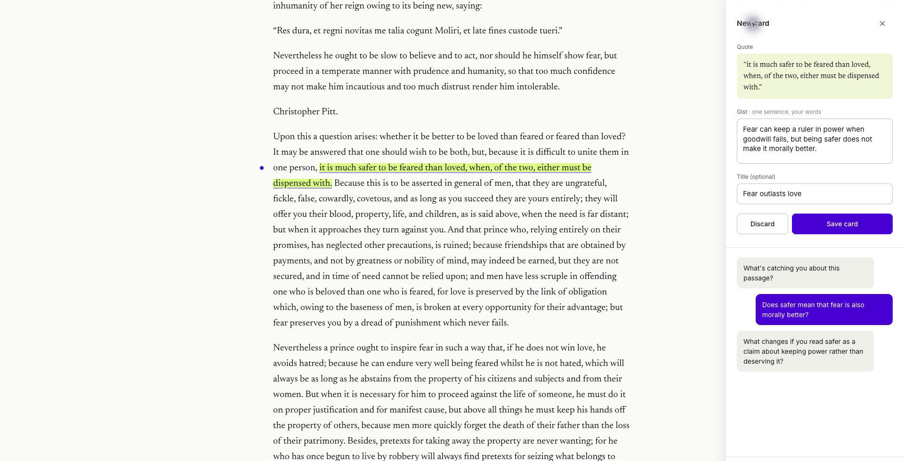
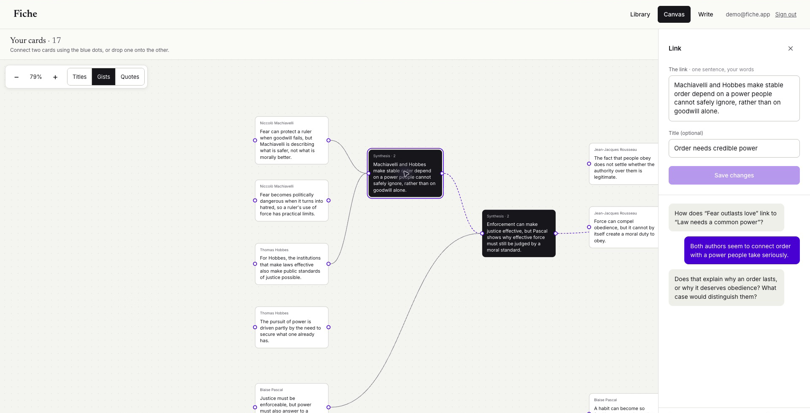
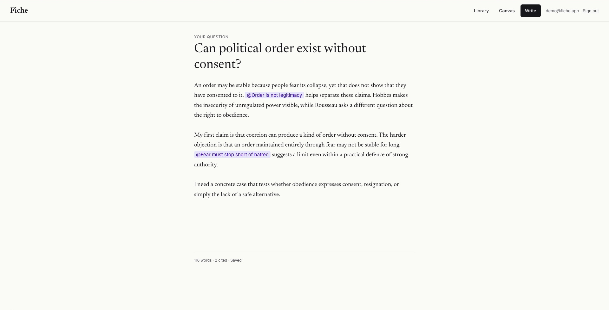

### What I built and why 
In France, they used to have an exam called the ENA "École Nationale d'Administration" which was a very competitive exam that allowed admission into a school of state administration. 

The exam involved answering an essay question in five hours, quoting from all the great books (Machiavelli, Plato, Leviathon etc). The point is, these people were meant to govern the country in the future, thus they were expected to have sophisticated worldviews around how best to govern and improve the lives of people. 

The tool that I built allows you to read these books in the browser, save quotations, paraphrase those quotes in your own words to understand the concepts, link concepts together in an ai-canvas setting, and practice writing mini-essays that bring all these concepts together. 


### Screenshots

**Quotation and card saving**



**Canvas**



**Essay**



### Key decisions made
Use AI in a pragmatic way, encouraging independent and critical thought from the reader. They still have to read the books, save quotes they find interesting, paraphrase in their own words, make the connections themselves on canvas, and write the essays themselves. 

AI has been added deliberately to aid thought. 

### What I'd add with more time 
Completing the learning loop with feedback. AI is currently only helping establish links between different concepts, or as a chat when saving a quote. However, I wanted to have the AI mark the essay (according to a default rubric or a predefined rubric) and then use that feedback as context in all chats. This would complete the "system evolves with the learner over time experience." 

Custom marking rubric, suggested essay questions, upload your own pdfs and books, add your own quote. 

### Things found challenging
- using the react flow library to implement dragging between two nodes, as well as triggering a synthesis session when that happened
- implementing the "@" functionality to resolve references when writing an essay 
- synthesising and linking more than two cards 


# Setup

Requires Node.js 22+ and a Postgres database.

From the project directory:

```bash
npm install
cp .env.example .env.local
```

In `.env.local`, set `DATABASE_URL` to your Postgres connection string and add `OPENROUTER_API_KEY` 

```bash
npm run db:migrate
npm run db:seed
npm run dev
```

Open [localhost:3000](http://localhost:3000). Sign in as `demo@fiche.app` with no password.